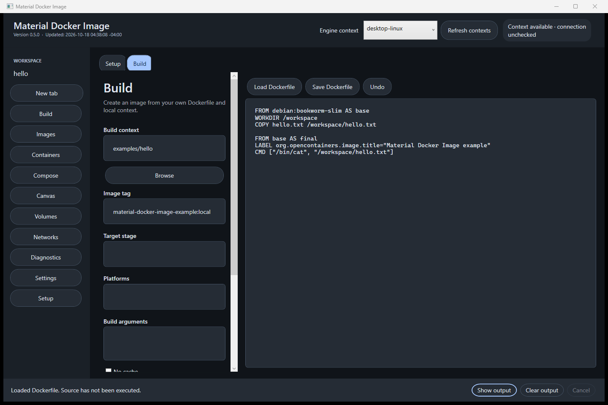
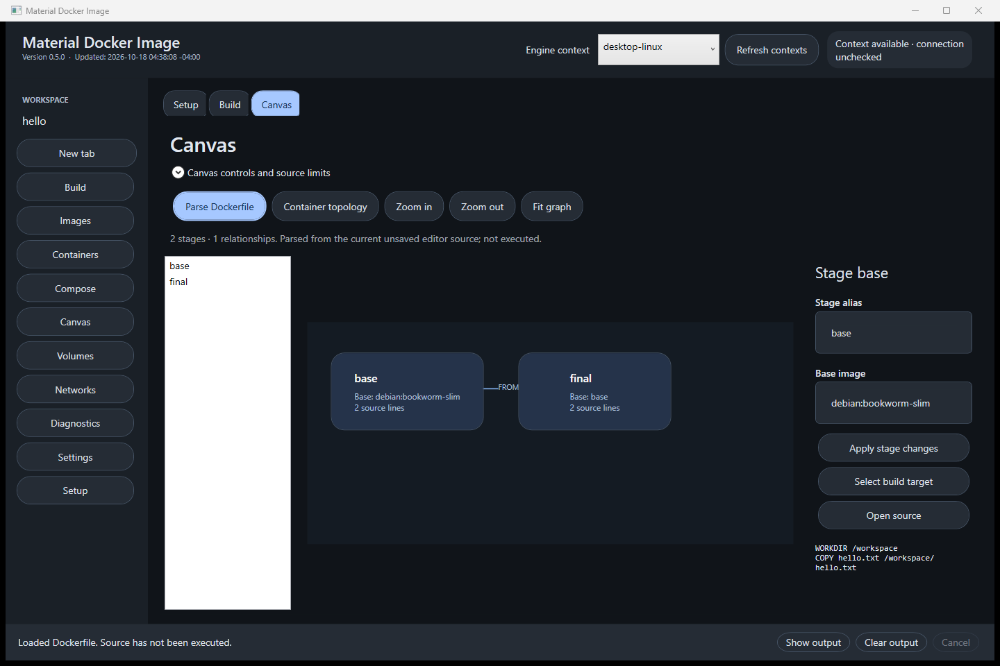
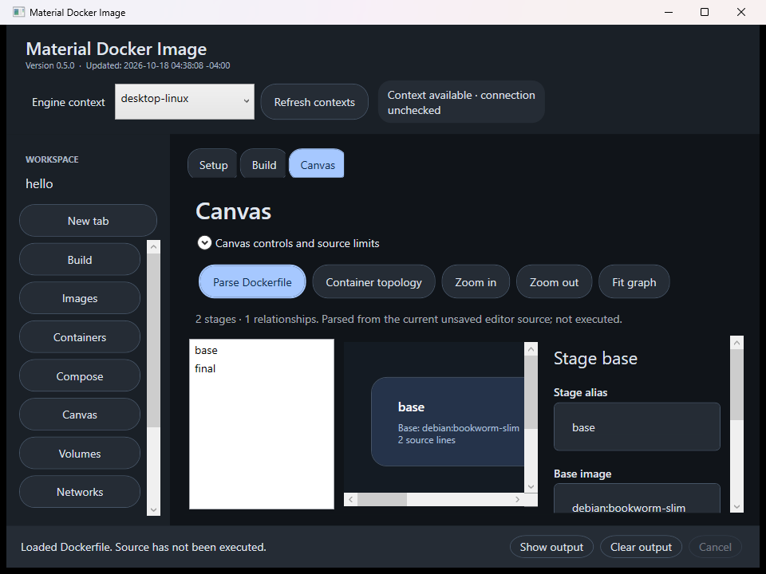

# Material Docker Image

A native Windows WPF workspace for building Docker images, running containers, managing resources, and exploring Dockerfile stages and container relationships on an interactive native canvas.

Advanced Build and Run controls are implemented. Focused checks pass, and a real native build/run workflow has been exercised. Complete required-feature acceptance remains open.

[Documentation](https://ding-ding-projects.github.io/material-docker-image/) · [Downloads](https://github.com/Ding-Ding-Projects/material-docker-image/releases) · [Capability inventory](docs/features/capability-inventory.md) · [Progress](https://github.com/Ding-Ding-Projects/material-docker-image/discussions/2)

## Build and run workflows

- Build local Dockerfiles with multiple tags, target stages, platforms, build arguments, image labels, pull/no-cache choices, and explicit local-load, registry-push or OCI-archive destinations.
- Configure BuildKit cache import/export and selected local secret files. Registry publication, cache export and existing OCI-file replacement require confirmation. Secret file contents are not read, logged or persisted by the application.
- Run images with explicit JSON argument arrays, non-secret environment rows, entrypoint, user, working directory, CPU/memory limits and restart policy.
- Add port and mount rows with explicit addresses, protocols and read-only choices. Ports default to loopback; additional mounts default to read-only. Remote bind paths refer to the selected engine host.
- Pull, inspect, tag, import, export and remove images; start, stop, restart, inspect and read logs/statistics for containers.
- Edit and operate Compose projects with loaded-save-path protection, and inspect volumes and networks on the selected engine.

OCI export, registry publication, cache backends and secret-file builds are implemented controls with focused input checks. Their complete runtime combinations have not been exercised. Health-check configuration, devices, GPU controls and interactive terminals remain gaps.

## Native canvas

Parse the current Dockerfile into selectable stages and dependency edges. Inspect stage source, change a supported stage alias/base, select an aliased build target, or jump back to its source line. Pan with middle-drag, scroll with arrow keys, zoom with Ctrl+wheel or buttons, and select through the keyboard-accessible object list. A compact header and separately scrolling inspector preserve graph space at the minimum supported window size.

Runtime topology reads actual container inspections and network/volume memberships. It is a bounded snapshot, not a live service-health guarantee. Unsupported Dockerfile constructs remain source-only without being rewritten or truncated. A parsed graph never claims the build ran.

## Current visual evidence

The retained and inspected native captures below belong to source `3ce1ed7895253edf8e0ccf99e6aaaca8a70ef22a`, local version 0.5.0. Build shows the restored example Dockerfile; advanced controls remain below the visible scroll position. The populated Canvas has two stages and one relationship. At minimum size, the graph supports intentional panning and the inspector scrolls.

Actual visual scope is English, dark theme and 100% display scaling at normal and minimum sizes. The complete language, theme and scale matrix remains incomplete.

## Verification and release state

- 23 core checks and 51 UI-state/parser checks passed through the exact build entrypoint.
- Source [f370d66](https://github.com/Ding-Ding-Projects/material-docker-image/commit/f370d66133ffc3fe5f80967f5bafb33c28bc74f2) completed a real native build/run workflow, including exact image-label and environment-value whitespace preservation.
- Normal release [v0.5.1](https://github.com/Ding-Ding-Projects/material-docker-image/releases/tag/v0.5.1) is the verified delivery baseline at source [ad5d3ac](https://github.com/Ding-Ding-Projects/material-docker-image/commit/ad5d3ac5c02588e8efcc926715119b87a9c7c6d5). Its [Windows build and release run](https://github.com/Ding-Ding-Projects/material-docker-image/actions/runs/39112649034) succeeded. The exact tag source and all five downloadable asset sizes/digests were verified.
- That baseline includes source [3ce1ed7](https://github.com/Ding-Ding-Projects/material-docker-image/commit/3ce1ed7895253edf8e0ccf99e6aaaca8a70ef22a), which restores the saved Build workspace. A real native Build resolved the relative example folder, and restart from another working directory without an open-file argument restored the saved folder and exact example source after line-ending normalization. The screenshots above retain their original 3ce1ed7/0.5.0 provenance.
- The existing installation was updated through its supported updater to 0.5.1.0, with the installed executable matching the published package and settings preserved. A hidden-desktop installed launch successfully detected Docker, exercised Setup Back/Next/Finish, persisted completion at step 2 and opened the productive Build workspace. This is bounded current-host update/launch/setup proof, not fresh-install or complete installer lifecycle acceptance.
- The [documentation deployment run](https://github.com/Ding-Ding-Projects/material-docker-image/actions/runs/39112649029) succeeded for ad5d3ac. The live documentation contains 12 articles, 109 neutral capability identifiers and three byte-identical source captures. Widths of 1440 and 320 pixels had no horizontal overflow; guide progress, checklist, theme and bilingual-choice persistence passed. The exact repository About homepage was read back as the documentation URL linked above.

All 109 required identifiers remain in the [capability inventory](docs/features/capability-inventory.md). Portable documentation/build companions, complete RegexBuddy parity and the full required-feature set remain incomplete.

## Build

Run `build.bat`. Docker operations require Docker CLI and a reachable selected engine. Editors and saved workspaces remain usable offline.

Run `build.bat -Tests` for focused engine and UI-state/parser checks, `build.bat -DockerSmoke` for an explicitly mutating, uniquely owned local-engine smoke, and `build-installer.bat` for the genuine unsigned Squirrel.Windows package. The smoke uses the local `desktop-linux` context and cached `debian:bookworm-slim` base image.

Native hidden-desktop verification can use `MaterialDockerImage.exe --software-rendering`. This selects WPF's supported software-rendering route and does not change Docker behavior.

## Safety

Commands use structured arguments without a host command shell. Existing Docker contexts and credential helpers remain owned by Docker. Destructive operations require explicit confirmation. Review Dockerfiles, writable mounts and registry destinations, and keep credentials out of ordinary environment rows and build arguments.
