# Material Docker Image

A native Windows WPF workspace for Docker: build images, create Dockerfiles step by step, run and manage containers, operate Compose projects, watch live statistics, clean up safely and keep a local history of every change. The whole interface follows Material 3 in a frameless window.

[Documentation](https://ding-ding-projects.github.io/material-docker-image/) · [Downloads](https://github.com/Ding-Ding-Projects/material-docker-image/releases) · [User guides](docs/features/README.md) · [Capability inventory](docs/features/capability-inventory.md) · [Design](design/workspace-redesign-2026-11/HANDOFF.md)

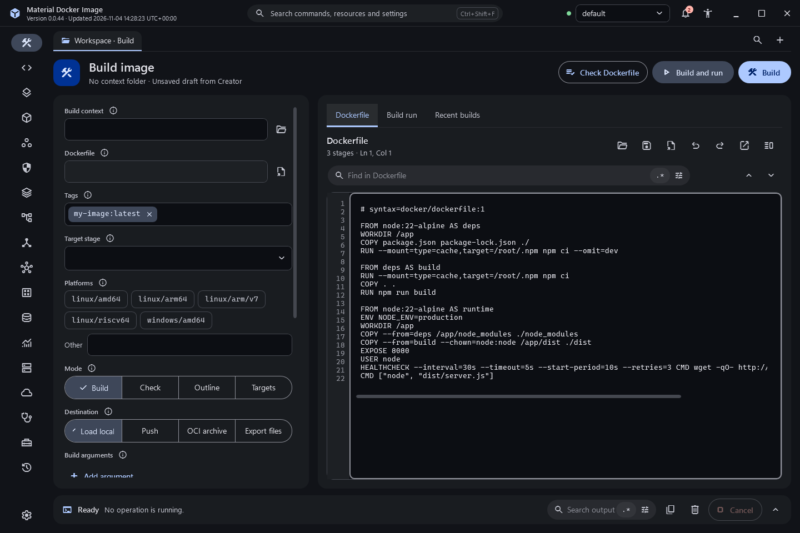

## What it does

- **Workspace**: custom title bar with version and build time, engine context selector that never changes the global Docker context, navigation rail, workspace and utility tabs, a `Ctrl+Shift+F` command palette with live setting controls, toasts with a notification centre, accessibility tools, and an operation panel with the real output of the running command. Every one of the 100+ search and filter fields has its own anchored regular expression builder (`Alt+R`) with a token palette, plain-English explanation, live tester, captures, replace preview and a pattern library, guarded by a completeness test.
- **Build and Bake**: context folder, Dockerfile editor, tags, target stage, platform chips, build arguments, labels, cache import and export, secret files and environment secrets (never read), SSH forwarding, named contexts, SBOM and provenance attestations, local load, push, OCI archive or exported files, BuildKit check, outline and targets modes, a live command preview, a step-by-step BuildKit timeline with cache hits and durations, a result card with digests, recent builds from Buildx history, and a Bake destination for `docker-bake.hcl` and Compose targets with overrides.
- **Dockerfile Creator**: project detection like `docker init`, starters for Node.js, Python, .NET, Go, Java, Rust and static sites, stages and structured instruction cards for every modern Dockerfile feature (all `RUN --mount` types with package-manager cache presets, heredocs, `COPY --parents` and `--exclude`, `ADD` from URLs and Git with checksums, global and platform arguments, parser directives), a live editable source that syncs both ways while keeping your comments and formatting, a .dockerignore editor with a live context check, 40+ best-practice checks matching BuildKit check names, with automatic fixes, undo history and hand-off to Build.
- **Editor suggestions**: IntelliSense-style suggestions in the Dockerfile and Compose editors (instructions, flags, mount options, stages, variables in scope, local images, build-context files, Compose keys), hover documentation, version-aware `# syntax` upgrades, and interactive pickers for paths, colours, ports, durations, permissions, users, platforms and images (`Ctrl+Space`, `Ctrl+Shift+Space`).
- **Images and security**: image detail tabs for layers with size bars, platforms and attestations from the registry manifest, Docker Scout vulnerabilities, SBOM packages and side-by-side compare, plus a Security destination that scans every local image.
- **Images and containers**: inventory with usage, pull, import, load, tag, push, save, prune; a run editor covering command, ports, environment, mounts, networks, resources, restart and health, security and advanced options with an exact command preview; container lifecycle, logs with follow and search, statistics, processes, file changes and copy, one-shot exec and a terminal window.
- **Compose, storage and canvas**: Compose projects with profiles, services, a path-bound source editor, watch, top, events, copy, exec, environment files and dry run; volumes and networks with create, connect, inspect, prune, backup, restore and clone; a native Dockerfile stage graph and runtime topology.
- **Contexts and Swarm**: engine context cards with live reachability, create, update, import and export without ever changing the global context, CLI plugins; Swarm init and join, services with task timelines, stacks, nodes, secrets and configs.
- **Minecraft servers**: create Java or Bedrock servers on the itzg images with a six-step wizard, then manage console and RCON, players, properties, files, backups and world pre-generation.
- **Monitor and System**: live CPU and memory charts, disk usage, engine information and category-by-category cleanup behind a two-key super confirmation.
- **Registry, Diagnostics and Tools**: registry sign-in with the password on standard input only, Docker Hub search, Buildx builders, read-only checks with sanitized reports, a live events stream, a Base64 toolkit and the offline documentation.
- **Local history**: an append-only history of settings, saved files, drafts and operations, kept in the application's own data folder, with diffs, restores, labels and export.
- **Appearance and motion**: an appearance editor with presets, a colour picker in eight colour formats with contrast badges, per-role colour overrides, shape, density, fonts and effects, a floating per-element editor (`Ctrl+Shift+E`), and Material 3 motion for pages, tabs, dialogs, notifications and controls with Off, Reduced, Standard and Expressive levels.
- **Settings**: English, Cantonese or bilingual copy on every page (about 3,400 phrases and templates) with funny levels and a personal wording file you can also drop anywhere on the window, accessibility, schedules for language and theme, setting locks, Focus, Low stimulation and Momentum modes, action sounds, engine, data and privacy, title-bar logo and display name. Each setting explains itself and says whether it is the default.
- **Records and updates**: an in-app changelog built from the project history, exports as CSV, TSV, JSON, Markdown and HTML from every list, menu shortcuts taken from the commands themselves, and a background update check that stages an unsigned update only after you confirm.
- **Small windows**: at the 960 x 720 minimum, lists keep their rows: the detail panel folds into a one-line summary with Show details, statistic tiles shrink to one line, and filter bars collapse.
- **Build companion**: `MaterialDockerImageBuild.exe`, a single-file window that runs `build.bat` and `build-installer.bat` with live output, the real exit code and cancellation.

## Screenshots

All captures come from the built application on a Windows Server 2025 runner with a real Windows container engine, run 41846028015 at source `4a17021` ([inventory](evidence/inventory.json), [earlier sets](evidence/screenshots-archive.md)). Light-theme and 960 x 720 minimum-size captures of every screen are in [`evidence/screenshots`](evidence/screenshots).

| | |
| --- | --- |
| 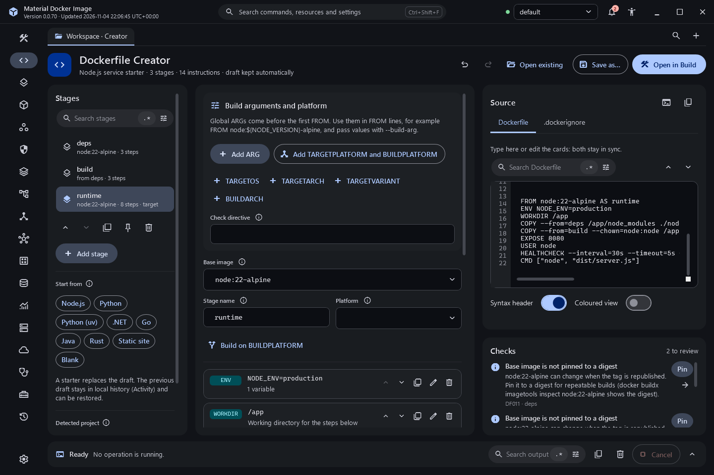 | 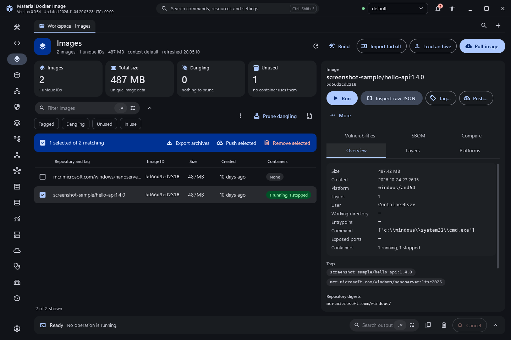 |
| 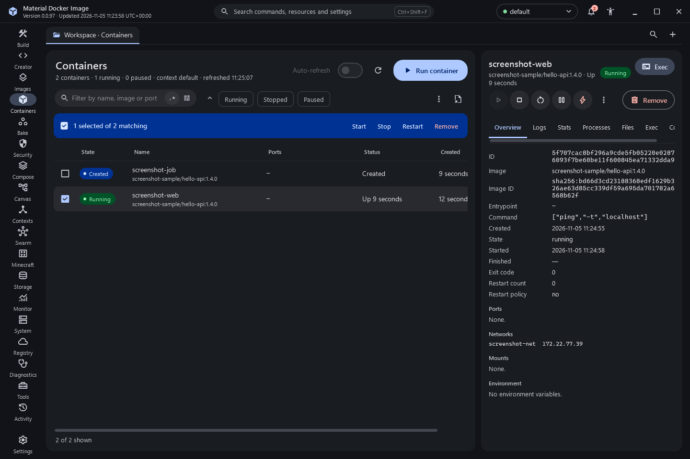 | 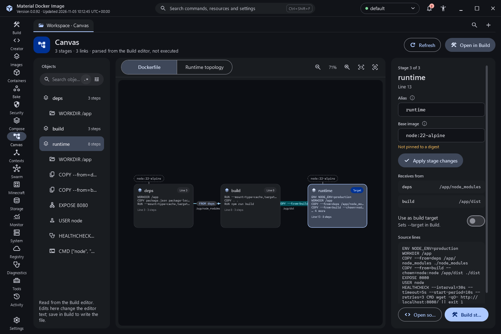 |
| 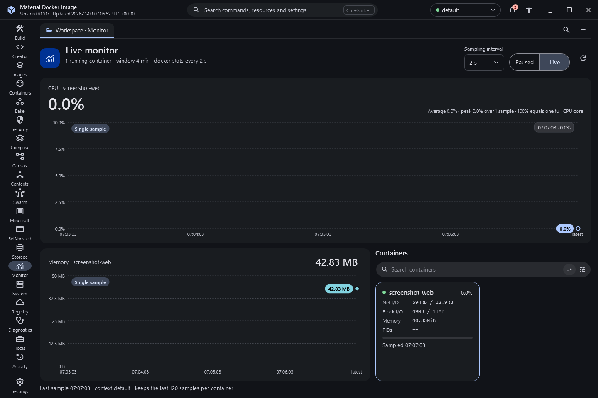 | 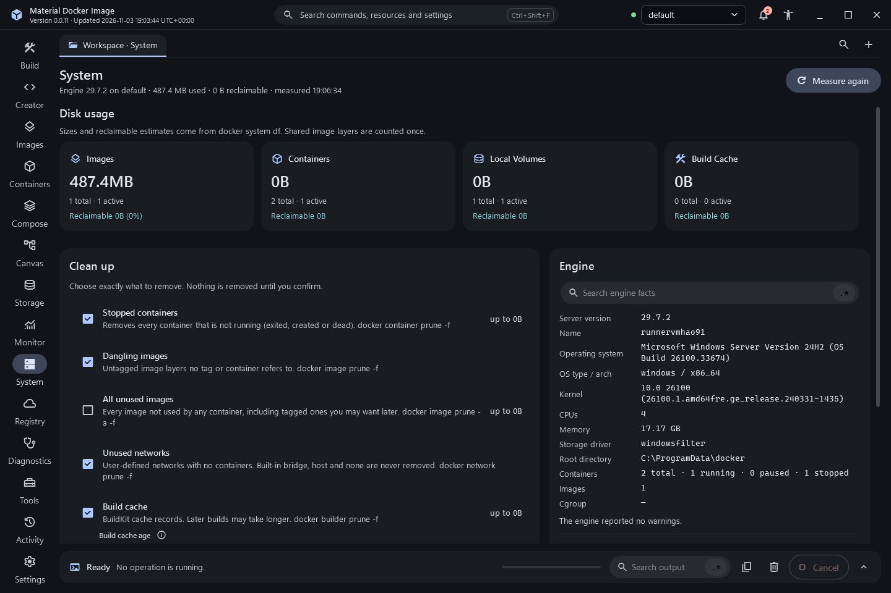 |
| 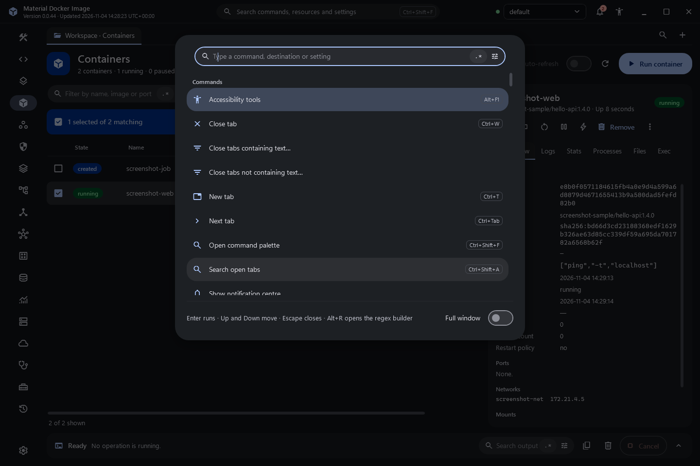 | 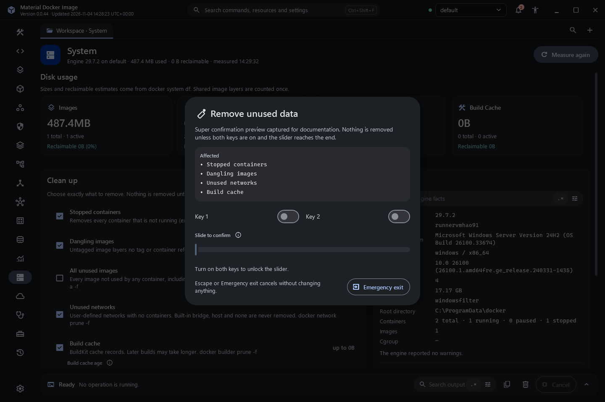 |
| 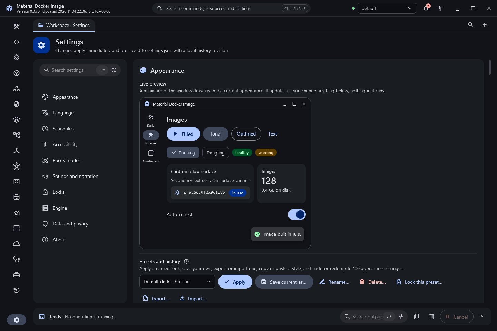 | 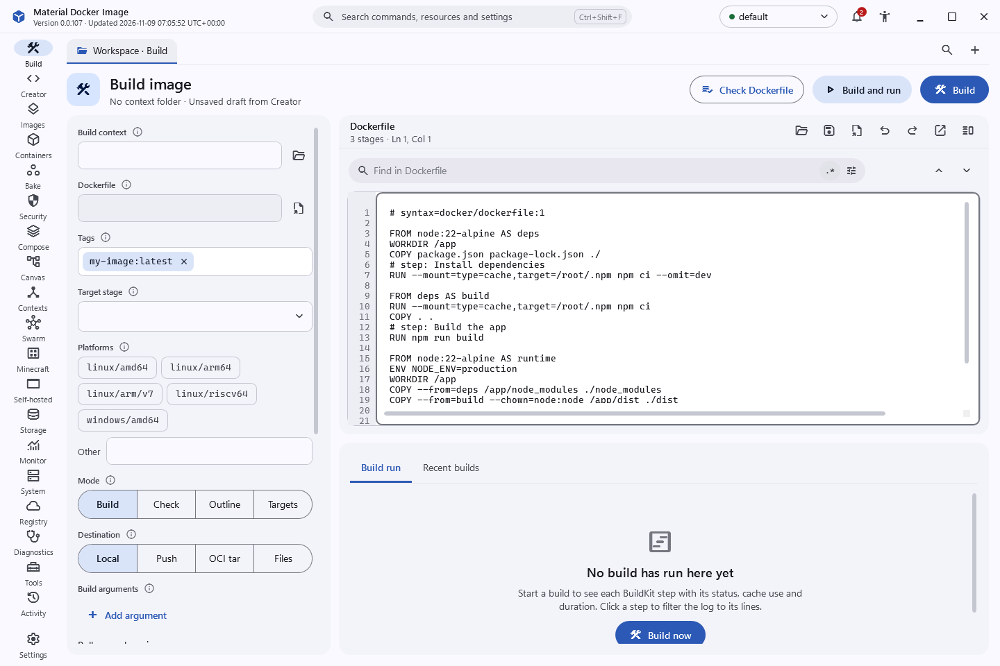 |
| 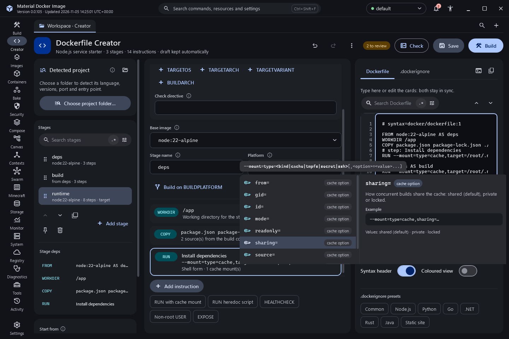 | 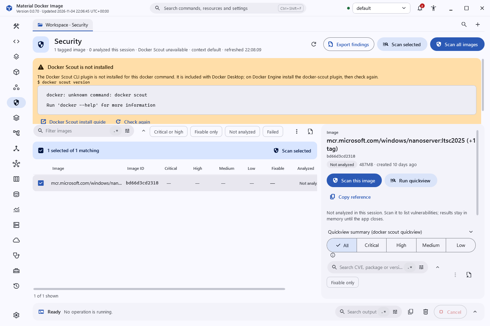 |
| 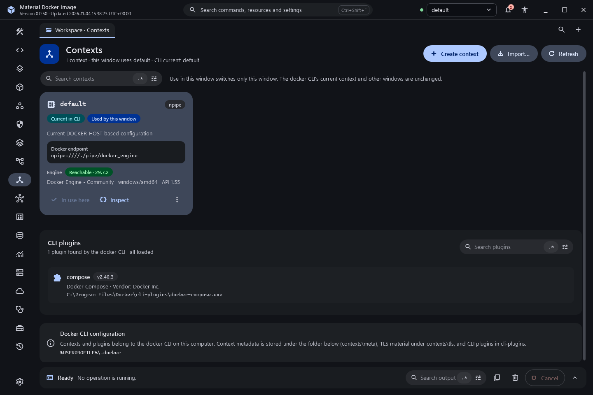 | 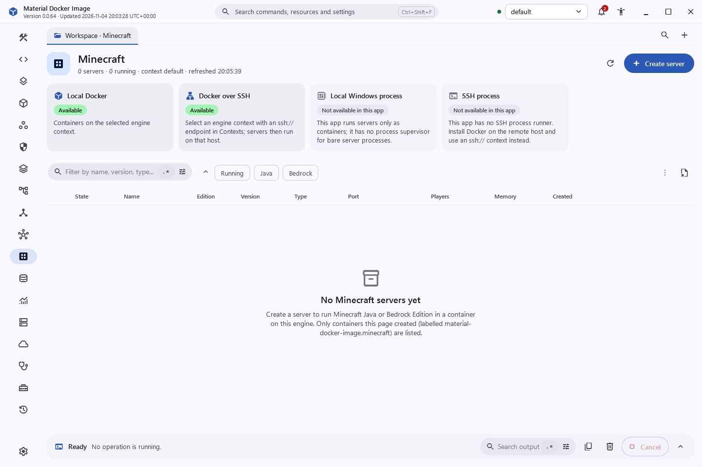 |

## Build

Run `build.bat` to publish the self-contained application, `build.bat -Tests` for the engine, UI-state and documentation checks, `build.bat -DockerSmoke` for an explicitly mutating local-engine smoke test, and `build-installer.bat` for the unsigned Squirrel.Windows package. Docker operations need the Docker CLI and a reachable engine; editors, the Creator, history and settings work offline.

`MaterialDockerImage.exe --capture <folder>` renders every destination, the command palette, the super confirmation and the notification centre to PNG files and exits. Add `--capture-theme Light`, `--capture-size 960x720`, `--capture-language Cantonese|Bilingual` or `--capture-scale 125|150|200`, and `--software-rendering` on machines without a GPU. Capture mode never writes your settings and never loads personal wording. The `Tests and screenshots` workflow runs the tests and these captures on every change.

## Safety

Commands use structured arguments without a host shell. The global Docker context and default Buildx builder are never changed. Registry passwords are passed on standard input and never stored or logged, and BuildKit secret files are never read. Removing data needs the two-key super confirmation; every operation reports its real exit status, and cancellation is never reported as success. Local history lives in the application data folder and never inside your projects.

## Verification state

The UI-state checks (1,082), core engine checks (23) and documentation checklist checks (24) pass through `build.bat -Tests` on Windows. The screenshots above show real engine data. The built application was also driven through UI Automation on a desktop host at 150 % scale: setup, listing, stopping, starting and reading logs of a labelled container, and a build from the companion, all confirmed against the engine ([receipt](evidence/interactive-2026-11/receipt.json)). Compose, prune, exec, history restore and sign-in have not been exercised that way yet, and the complete required-feature inventory remains open; see the [feature audit](evidence/uh-features-audit.md), [capability inventory](docs/features/capability-inventory.md) and [handoff](HANDOFF.md).
