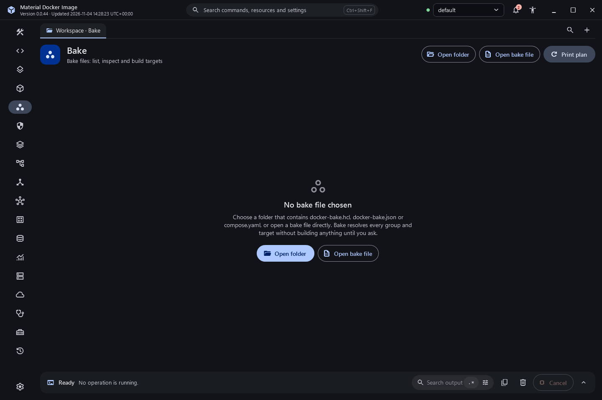

# Advanced image builds

The Build workspace keeps the Dockerfile editor beside the selected local context. Advanced controls expand in place and use structured Docker CLI arguments.

## Outputs

- **Load into local engine** is the default. This editor accepts one platform for a local load.
- **Push to registry** accepts multiple tags and platforms and requires confirmation naming the destination tags. Docker retains ownership of registry authentication.
- **Export OCI archive** writes to a selected local archive path. The parent directory must exist, and replacing an existing archive requires confirmation. Exporter availability depends on the installed builder.

The Image tag field accepts comma-separated or line-separated tags. Labels use one `key=value` per line. Label keys support namespace punctuation; values retain spaces exactly. The application does not shell-interpret values.

## Cache

Cache import and export accept one BuildKit specification per line, such as `type=local,src=C:/cache` or `type=registry,ref=registry.example/team/cache`. The installed builder decides which backends it supports. Export is a write operation and requires confirmation. Do not place credentials in these fields.

## BuildKit secret files

Add a secret row, choose an existing local file, and enter the identifier used by the Dockerfile's `RUN --mount=type=secret` instruction. The application passes the selected path to BuildKit without reading or persisting the file's contents. Selections remain in the current window only. The Dockerfile itself must avoid printing secrets or copying them into an image.

## Check before building

**Check Dockerfile with BuildKit** invokes the installed builder's actual `--check` route against the saved Dockerfile. Unsupported builder versions report their real error. A check is distinct from a successful build, image load, registry publication or container health result.

## BuildKit timeline

Builds run with `--progress=plain` and the output is parsed into a timeline: one row per step with its stage, status (running, cached, done, failed, cancelled), a duration bar scaled to the longest step and the step's own log. Statistics tiles show total time, cached steps, step count and the resulting digest. Click a step to filter the log to it. A failure shows the "failed to solve" summary as a banner.

After a successful build the metadata file is read to show the image digest, config digest, names and attestations, with Run, Push and Copy digest. Recent builds combines this session's builds with `docker buildx history ls` when the installed Buildx supports it, and says so when it does not.

## More options

- Platform chips for common platforms plus any other platform; a local load refuses more than one.
- Mode: Build, Check, Outline (build arguments and secrets the Dockerfile uses) and Targets (stages you can build, with Use as target).
- Export files writes the result to a local folder and asks before writing into a non-empty one.
- Named build contexts, SSH agent forwarding, environment-variable secrets (the value is never read or shown), SBOM and provenance attestations, annotations, RUN network mode (host needs the network.host entitlement), shared memory size, ulimits and extra hosts.
- A live command preview with copy shows exactly what will run, or why the input is invalid.

## Bake

The Bake destination opens a folder (Bake reads its default files such as `docker-bake.hcl` and `compose.yaml`) or a specific file. It lists groups and targets from `docker buildx bake --list=targets` and the resolved definition of each from `--print`. Select targets or a group, add `--set` overrides, choose Load, Push or the file's own outputs, and build with the same timeline as Build. Push asks first; Load refuses multi-platform targets unless you override the platform.

## Limits and verification

Input validation has focused regression coverage. Successful local builds have been exercised separately from remote registry, cache-backend and multi-architecture acceptance. Those latter paths remain capability-dependent and are not inferred from a local build.

## 廣東話

建置頁可以揀載入本機引擎、發布去登錄服務，或者匯出 OCI 封存檔。發布同覆寫都會清楚確認目的地。標籤值保留原本空格，唔經主機命令殼層。快取支援程度由實際建置器決定。秘密檔案只傳路徑畀 BuildKit，介面唔讀取內容；Dockerfile 本身亦唔可以印出或者複製秘密。檢查通過唔等於建置、發布或者服務健康已經通過。
