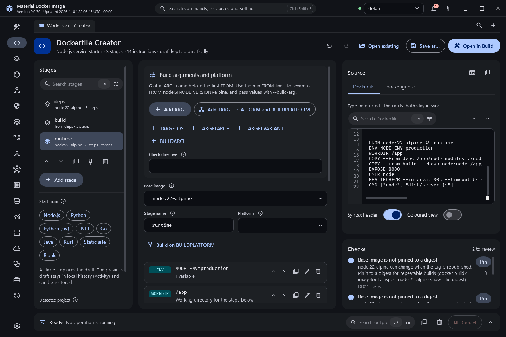
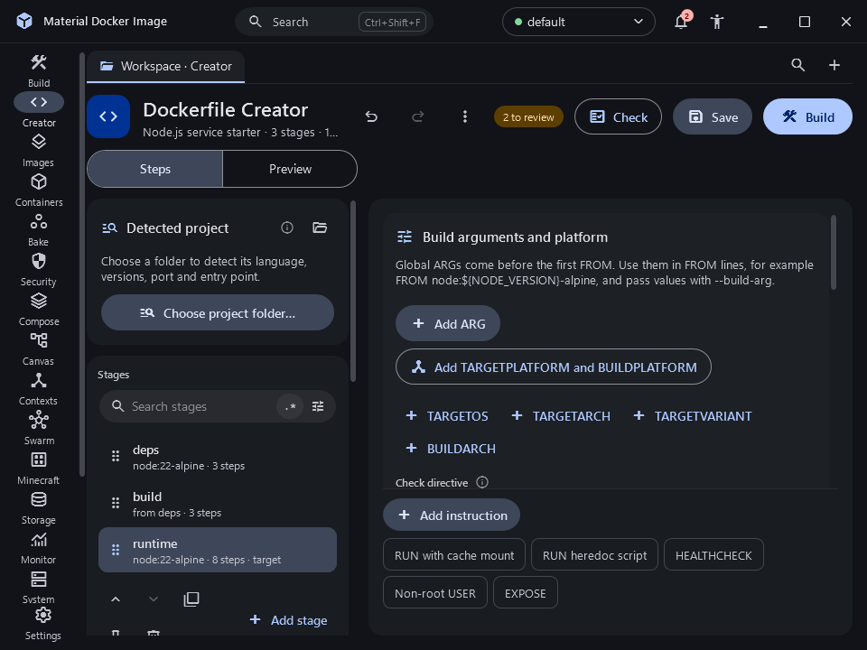

# Dockerfile Creator

The Creator builds a Dockerfile from structured steps, shows the exact text as you work, and checks it against common best practices.

## Start

Choose a starter (Start from, under the stages, or the More menu in the header): Node.js service, Python with pip, Python with uv, .NET (ASP.NET), Go static binary, Java (Maven build with a JRE runtime), Rust, static site served by an unprivileged nginx, or Blank. Each starter states what it creates. Applying a starter replaces the current draft; the previous draft is recorded in local history first so it can be restored from Activity. You can also import an existing Dockerfile from the More menu: instructions become structured steps, and anything the editor cannot represent is kept as a raw card with Edit as text.

The Detected project card inspects a folder like `docker init`: Node (npm, yarn, pnpm), Python (pip, uv, poetry; FastAPI, Flask, Django), Go, .NET, Rust, Java (Maven, Gradle) and static sites, plus existing Dockerfile, Compose and .dockerignore files. Each finding is a tile with the files it was read from. Apply suggestion replaces the draft (the old draft goes to local history first), and Write to folder asks before replacing any file.

## Stages

The left column holds the Detected project card, the stages and, under them, the outline of the selected stage: its `FROM` line and one row per instruction. Clicking a row opens that step. Add, rename, duplicate, delete (with confirmation), reorder, or set a stage as the build target. Each stage has a base image (editable, with common images suggested), a name and an optional platform.

## Steps

Each instruction is a card with its keyword, a summary and a hint. Click a card (or press Enter) to open it: the centre then shows only that step, with its keyword, a title, its position, Previous and Next step buttons, Collapse (Esc) and the step menu, and a form specific to its kind:

- `ARG`, `ENV` and `LABEL` as name and value rows.
- `COPY` with sources, destination, `--from` stage, `--chown`, `--chmod` (numeric or symbolic), `--link`, `--parents`, repeated `--exclude` and an inline file written as a heredoc.
- `ADD` from a local path, a URL or a Git repository, with `--checksum` and `--keep-git-dir`.
- `RUN` as shell or exec form or as a heredoc script with an interpreter, plus a mounts editor for all five mount types (bind, cache, tmpfs, secret, ssh): each mount is a compact row with its type, target, key option (id, source or size) and remaining options, and its options button opens every other field, cache presets for apt, npm, pip, uv, Go, Cargo, NuGet, Maven and Gradle, and `--network` and `--security` (insecure warns about the entitlement it needs).
- Global build arguments before the first stage, one-click `TARGETPLATFORM` and `BUILDPLATFORM` helpers, Build on BUILDPLATFORM for cross-compilation, and the `# syntax`, `# escape` and `# check` directives.
- `USER`, `WORKDIR`, `EXPOSE` (port and protocol), `VOLUME`, `STOPSIGNAL`, `SHELL`, `ONBUILD` and comments.
- `ENTRYPOINT` and `CMD` in exec form with one field per argument.
- `HEALTHCHECK` with command, interval, timeout, retries and start period.

Any step except a comment can have a name, such as "Install dependencies". Choose Rename step in the step menu, press F2 on a card or in the open step, double-click the open step's title, or run "Creator: rename the open step" from the command palette; Enter saves, Escape cancels and an empty name removes it. The name replaces the kind title ("Run commands") in the open step, appears above the summary on the card and replaces the argument in the outline. It is stored in the Dockerfile itself as an ordinary comment directly above the instruction, `# step: Install dependencies`, so the file stays valid for every builder and the name survives saving, reopening and editing the source by hand. The parser attaches a `# step:` line only when the next line is the instruction (not a blank line, another comment or `FROM`); other comments above it stay separate comment cards. Renaming patches only that one line, keeps CRLF line endings, and undo and redo cover it. The Node.js starter names its two build steps.

The `RUN` form follows the order mounts, network and security, then the Heredoc script switch and the script or command. Fields are validated as you type. Move steps with the arrow buttons or Alt+Up and Alt+Down; duplicate or delete them from the card or its context menu. Add instruction opens a searchable list, and quick-add chips insert a cached `RUN`, a `HEALTHCHECK`, a non-root `USER` or an `EXPOSE`.

## Live, editable source

The source on the right is an editor, not just a preview. Type in it and, 300 ms after you stop (or when it loses focus), the stages and cards are rebuilt from your text without moving the caret or scroll position. Editing a card replaces only that instruction's lines, so your comments, blank lines, spacing and CRLF line endings are kept. Opening a card selects its lines in the source; moving the caret selects the matching stage and outlines its card. Lines the model cannot represent become raw cards with Edit as text, and parse notes appear in Checks with a link to the line. Adding, removing or moving steps and editing directives still re-render the whole file.

The source has search, a coloured read-only view, Copy as build command (`docker buildx build` with target, entitlements, secret ids and SSH, never secret values), a .dockerignore tab with pattern rows and a live check against a context folder (the .dockerignore preset chips sit at the foot of the preview; a ticked preset has all its patterns listed, and clicking it again removes them), and a compose.yaml tab when one is generated.

## Checks

Check in the header runs the checks and lists them under the button; the badge beside it shows how many need review. The checks report, among others: an unpinned base image, a final stage that runs as root, no health check, `apt-get update` without an install in the same step, missing `--no-install-recommends` or cleanup, `ADD` used for local files, shell-form `CMD` or `ENTRYPOINT`, a web service without `EXPOSE`, `COPY . .` before dependency installation, secret-looking `ARG` or `ENV` names, duplicate stage names, `COPY --from` pointing to an unknown or later stage, a relative `WORKDIR`, and several `CMD` instructions. Rules DF100 to DF124 add mount, heredoc, platform and syntax-version checks; DF116 offers to add or upgrade the `# syntax` header when a feature needs a newer Dockerfile frontend. Findings that match a BuildKit check show its name, and `# check=skip=` hides them here too. Most findings have a Fix button; fixes that need a value (such as a tag or digest to pin) ask for it first.

## Saving and building

Undo and Redo keep the last 200 changes. The draft is saved automatically in the application data folder and recorded in local history after two seconds without changes. Save writes to the file the draft was last saved to (and asks where the first time); Save as, in the More menu, writes a Dockerfile you choose. The subtitle says when the draft has unsaved changes since then. Build sends the text to the Build destination as an unsaved draft together with the selected target stage, so you can review it and build.

## Screenshots

Captured from the built application ([inventory](../../evidence/inventory.json)).

