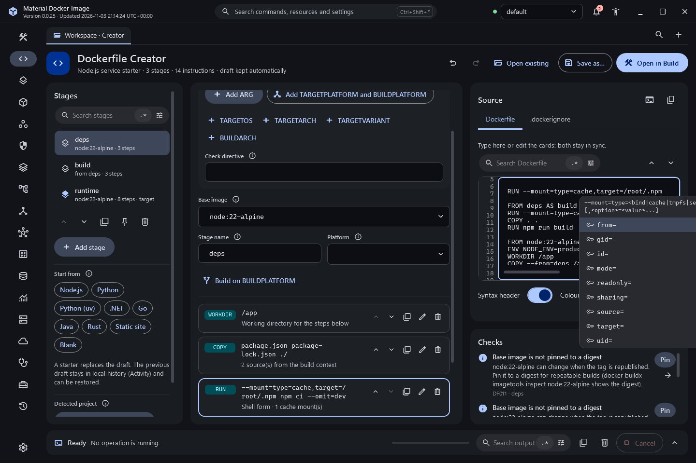

# Editor suggestions and value pickers

The Build Dockerfile editor, the Creator's editable source and the Compose file editor share one suggestion engine.

## Suggestions

Suggestions open after a short pause in typing or after a trigger character (`-`, `=`, `$`, `{`, `:`, `/`, `,`, `#` or a space), and always with `Ctrl+Space`. Use Up, Down, Page Up and Page Down to move, Tab or Enter to accept and Esc to close. Matching characters are shown in bold, every item has an icon for its kind, and the side pane shows its description, an example and the minimum `# syntax` version it needs. Accepted text goes through the editor, so `Ctrl+Z` undoes it.

In a Dockerfile, suggestions follow what is at the cursor:

- At the start of a line: every instruction, parser directives at the top of the file, and snippets such as a cached package install or a health check.
- After an instruction: the flags that instruction accepts, without the ones already used.
- Inside `--mount=`: the mount types, the options valid for the chosen type, and their values.
- `--from=` and `FROM`: stages defined earlier in the file.
- After `$` or `${`: the build arguments and environment variables in scope, including the platform arguments. A global argument used inside a stage without being declared there is marked.
- After `FROM`: your local images and a clearly labelled list of popular official images; after `:`, the tags of local images.
- After `COPY` and `ADD`: names from the build context (up to 500), skipping entries excluded by `.dockerignore`, symbolic links and names that look like secrets. File contents are never read.
- Values for `EXPOSE`, `STOPSIGNAL`, `SHELL`, `USER`, `HEALTHCHECK` and OCI label keys.

A hint line under the cursor shows the instruction's full form, and resting the mouse on a keyword, flag, mount option, directive or Compose key for half a second shows its documentation. Items that need a newer Dockerfile frontend than the file declares carry a badge such as "1.4+"; after accepting one, `Ctrl+Enter` adds or upgrades the `# syntax=docker/dockerfile:1` header.

In Compose files, keys are suggested by indentation (top level, service, build, health check, `depends_on`, `develop.watch`, deploy, logging, ports and volumes in long form, and the top-level volumes, networks, secrets and configs), together with values and the names of your services, volumes, networks, secrets, configs and profiles.

## Value pickers

When the value at the cursor has a known type, the list offers a picker and `Ctrl+Shift+Space` opens it directly. Tab moves inside a picker, Enter applies the value and Esc returns to the editor with the cursor where it was.

- **Path**: a file or folder dialog that opens at the build context or Compose folder and inserts a relative path with forward slashes. Paths outside the build context are refused for `COPY` and `ADD`, with an explanation.
- **Colour**: the colour picker from the appearance editor, keeping the original notation.
- **Port**: container port and protocol, plus host port and address for Compose, with warnings for privileged ports and host ports already published on the engine.
- **Duration**: presets and a number with a unit, for health check timings.
- **Permissions**: an owner, group and other grid for `--chmod`, producing octal or symbolic form.
- **User**: common users (root, node, nobody, 65532) and a numeric uid:gid editor.
- **Platform**: chips for common platforms.
- **Image**: a searchable list of local images and tags, with Pin digest using the image's real repository digest (disabled when there is none).
- **Fixed choices** such as signals, restart policies, mount types and sharing modes: chips.
- **Secret-looking variables**: Use a build secret instead rewrites the line to `RUN --mount=type=secret,id=…,env=NAME`. The value is dropped and never shown.

## Settings and commands

Settings > Engine has **Show suggestions while typing** (on by default). `Ctrl+Space` and `Ctrl+Shift+Space` always work. The command palette has Trigger suggestions, Pick value at caret and a switch for the setting.

## Status

Built and covered by UI-state checks for every suggestion context, scoping, fuzzy ranking, version badges, Compose indentation and each picker's value type. Popup placement, focus behaviour and the pickers have not yet been exercised interactively on Windows. `Ctrl+Space` can clash with the input-method toggle in some Chinese input setups; the palette command works there.

## Screenshots

