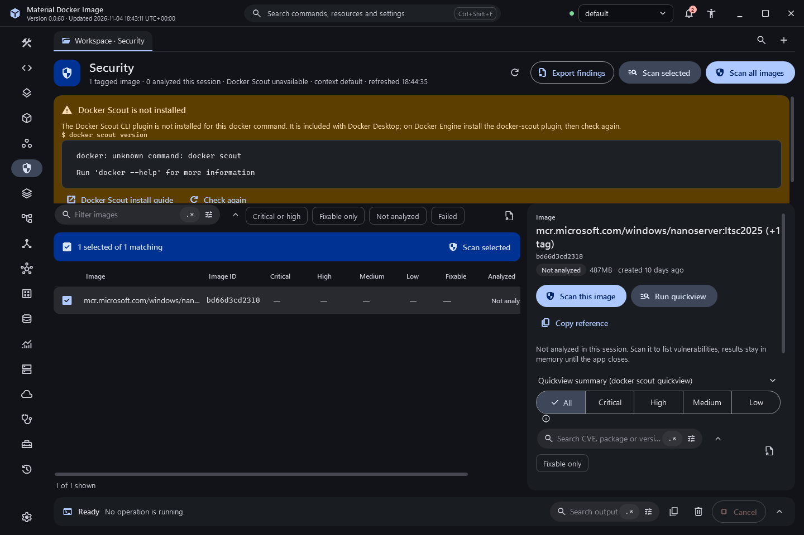

# Image detail and security

## Image detail

Select an image in Images to open its detail beside the list (below the list on narrow windows). The detail has six tabs; each loads the first time you open it and the chosen tab is kept when you select another image.

- **Overview**: identity, size, platform, tags and environment variable names. Values stay hidden.
- **Layers**: one row per build step with the instruction keyword, the cleaned instruction, size, age and a size bar relative to the largest layer. Hide empty layers, search and copy are available.
  When the image was built from the Build page in this session (its result digest is this image), or when the Dockerfile now in the Build editor accounts for every step, each row names its source: "Your Dockerfile, line N" (with "from stage X" for `COPY --from`), and the steps below the first `FROM` read "Base: <image>". The match is exact after removing BuildKit's recorded prefixes (`/bin/sh -c`, `|N NAME=value`, `# buildkit`) and expanding build arguments from the recorded `ARG` and `ENV` steps. If any instruction does not match, or two stages fit with different lines, no source is shown at all. `HEALTHCHECK`, `ONBUILD` and heredoc instructions are accounted for by keyword only and get no line note.
- **Platforms**: the local platform and repository digests, and the registry manifest read with `docker buildx imagetools inspect --raw`. Each platform is a card, attestation manifests are matched to the platform they describe, and the raw manifest has its own viewer. Images without a digest only query the registry when you ask.
- **Vulnerabilities**: runs `docker scout cves` and shows severity tiles and a findings table with severity, fixable-only and search filters and export. A finding opens a detail card; advisories open only after you confirm.
- **SBOM**: the package list from `docker scout sbom` with counts per package type, and an export of the exact JSON.
- **Compare**: pick another local image to compare size, layers, platform, user, working directory, entrypoint, command, environment names, ports and labels side by side, or run `docker scout compare`.

If Docker Scout is not installed, not signed in, or the analysis fails, the tab says so and shows the exact output. No finding or count is shown unless an analysis really ran.

The Scout summary beside the Layers table has a **Base image recommendation** block. **Get recommendations** runs `docker scout recommendations <image>` only when you ask, because it contacts Docker's service. The block shows the base image Docker Scout detected with its vulnerability counts and size, then up to three tags from the "Refresh base image" and "Change base image" tables with their counts, the printed change against the current base (for example "1 fewer High, 17 more Low"), size and push age. It also says when the base image was only auto-detected, when the base is up to date, when the image has no base image, and when Scout is missing, needs sign-in or failed (with the exact output to copy). The result is kept for the session per engine context and image.

The Images list also has a statistics strip (images, total size, dangling, unused) and the row actions Retag to multiple, Push all tags of repository and Copy pull command.

## Security

The Security destination lists tagged local images with critical, high, medium and low counts, the fixable count and when each was analysed. Filter by critical or high, fixable only, not analysed or failed. Scans run one image at a time in the background, can be cancelled, and stop early if Scout is missing or needs sign-in. Results are kept for the session per engine context and image, and are shared with the Vulnerabilities tab. Export findings saves JSON or CSV; CSV cells are protected against spreadsheet formula injection.

## Screenshots

