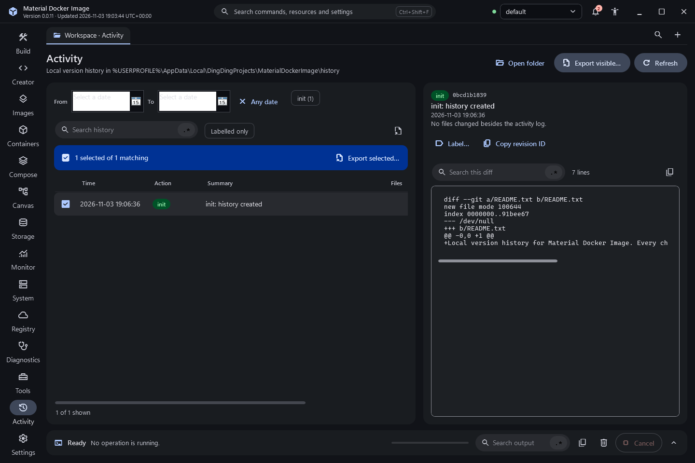

# Local history

Every meaningful change is recorded in a local version history so it can be reviewed, compared and restored.

## Where it lives

The history is a Git repository in the application's own data folder:
`%LOCALAPPDATA%\DingDingProjects\MaterialDockerImage\history`. It is never created inside your project folders, and nothing in it is sent anywhere.

## What is recorded

- Settings changes (the complete settings file at each change).
- Dockerfile and Compose saves, and Dockerfile Creator drafts, with their content.
- Operations: the label, result and engine context of each build, run, removal or prune. Command arguments are not recorded, so environment values never enter the history.
- Discarded drafts when the window closes with unsaved work.

Passwords and BuildKit secret file contents are never recorded.

## Using it

The Activity destination lists revisions with time, action and summary. Filter by action, by date range and by text (with the regular expression builder). Select a revision to see its diff.

- **Restore** writes the chosen file content as a new revision. History is append-only: a restore never rewrites earlier revisions, and a restore can itself be restored.
- **Label** names a revision so it is easy to find later.
- **Export** writes the selected or visible revisions to a ZIP file with a JSON index and one patch per revision.

If the history cannot be opened or written, the Activity destination says so. A history failure never fails the operation you were running.

## Screenshots

Captured from the built application ([inventory](../../evidence/inventory.json)).

