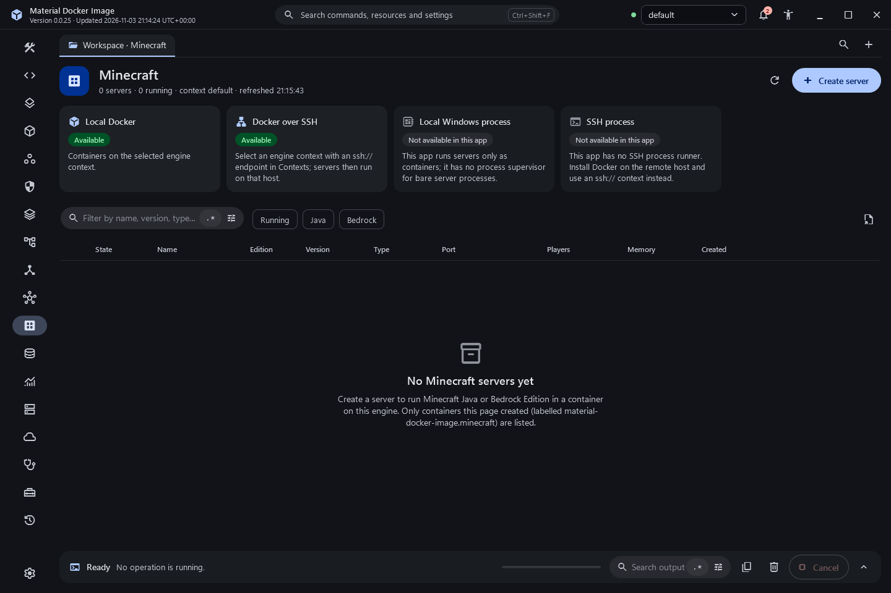

# Minecraft servers

The Minecraft destination creates and runs Minecraft servers as containers using the community `itzg/minecraft-server` (Java) and `itzg/minecraft-bedrock-server` (Bedrock) images. It lists only containers and volumes labelled `material-docker-image.minecraft`, so your other containers are never touched.

## Create a server

A six-step wizard with Back and Next:

1. **Where**: the local engine or an SSH engine context.
2. **Edition and version**: latest, snapshot or preview, or a typed version. Refresh versions downloads the official version list through a pinned helper container.
3. **Server type**: Vanilla, Paper, Purpur, Fabric, Forge, NeoForge and the other types the image supports, or a custom server jar.
4. **Resources and network**: memory, port and listen address (127.0.0.1 by default, with a warning for 0.0.0.0). Bedrock uses 19132/udp.
5. **Game settings**: typed controls for server.properties, operators, whitelist, and Modrinth or Spigot plugins where the type supports them.
6. **Review**: the exact command preview and the Minecraft EULA. The server is only told the EULA is accepted when you tick the box.

The RCON password is passed in a temporary environment file that is deleted straight away, and is shown as dots in the preview. The Java runtime image tag is chosen from the version.

## Manage a server

- **Overview**: live statistics, uptime and the connect address.
- **Console**: follows the server log with search and command history, and sends commands through RCON (Bedrock through the image's command helper).
- **Players**: online players, operators and whitelist, with op, deop, whitelist and kick.
- **Properties**: shows the differences, then recreates the container with the new settings. The old container is kept until the new one starts, and the world volume and password are kept.
- **Files**: browse `/data` and copy files in and out, confirming before overwriting.
- **Backups**: pauses saving, archives the world in a helper container, copies it to the folder you choose and resumes saving. Restore needs the super confirmation and writes a safety backup first.
- **World**: draw an area on a chunk grid and pre-generate it with the Chunky plugin, with progress from the log. Export the world to a folder or a ZIP file.

Stop saves the world and then stops the container with a 60-second grace period. Removing a server asks first; deleting the world volume as well is off by default and needs the super confirmation.

## Status

Built and covered by UI-state checks for versions, image tags, settings, secret handling and output parsing. The pages have not yet been exercised against a real engine; Bedrock settings names, Chunky output and the Java 25 tag for 26.x versions need confirmation on a real server.

