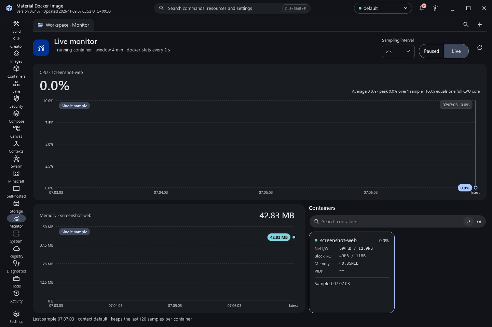
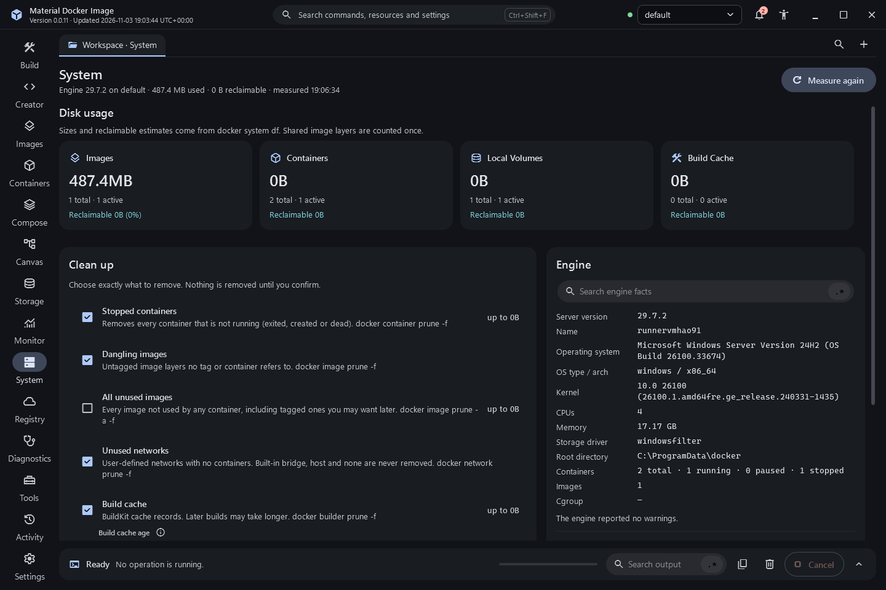
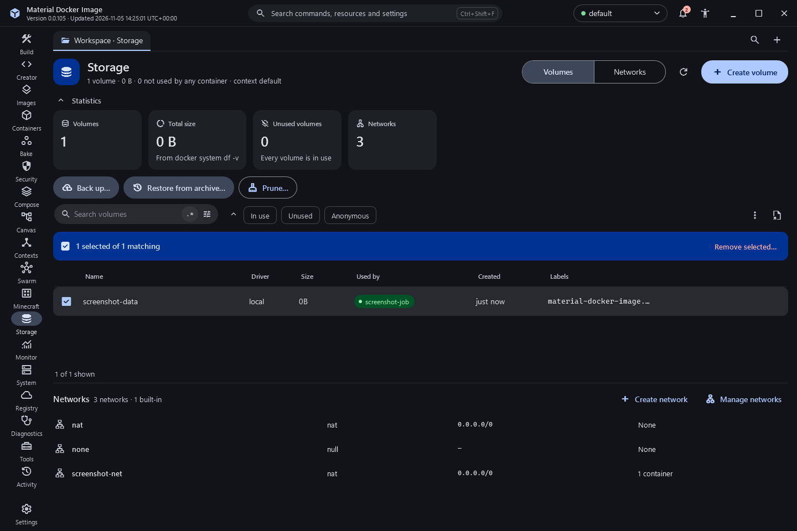
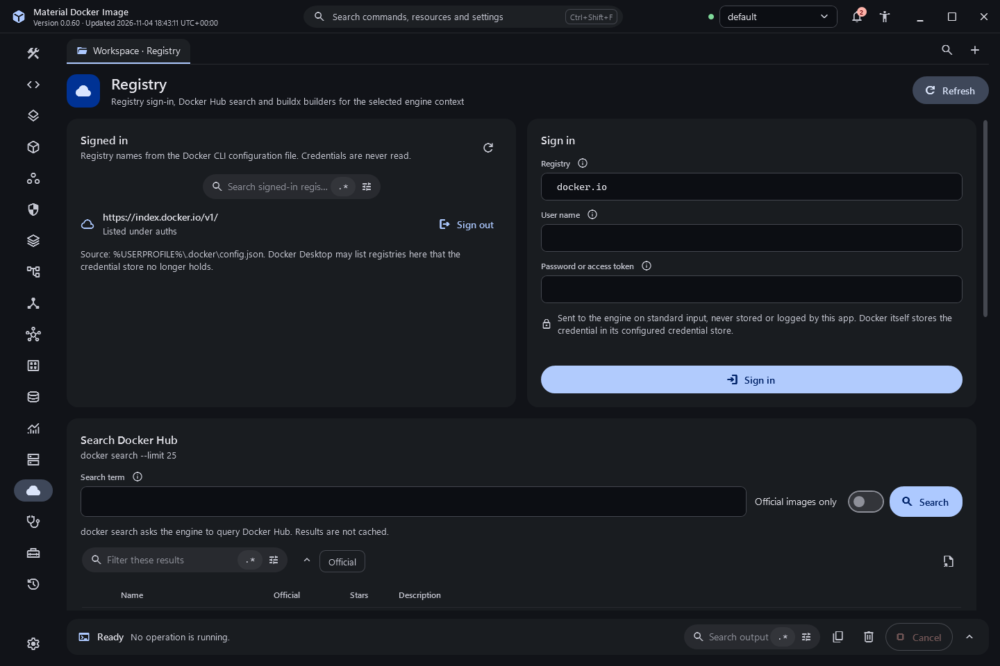
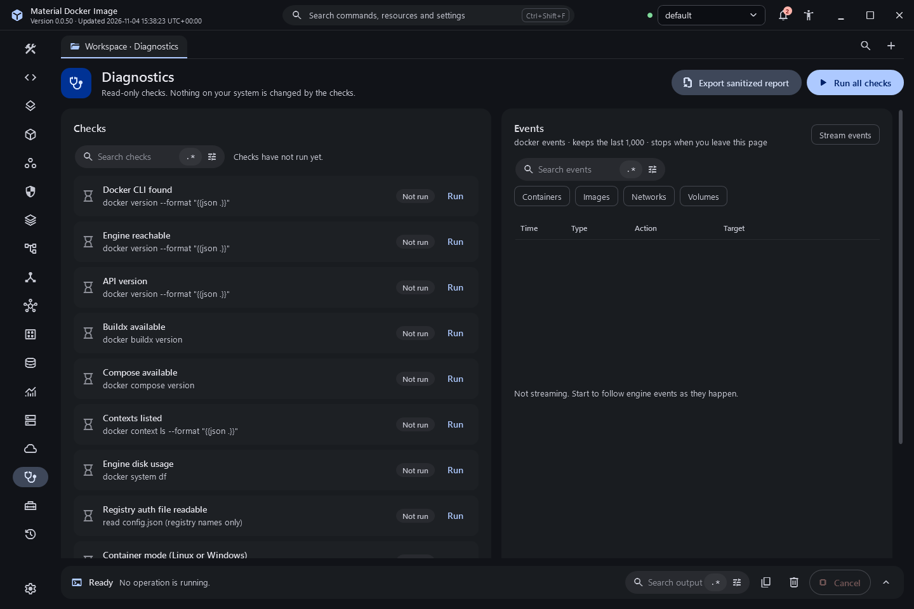
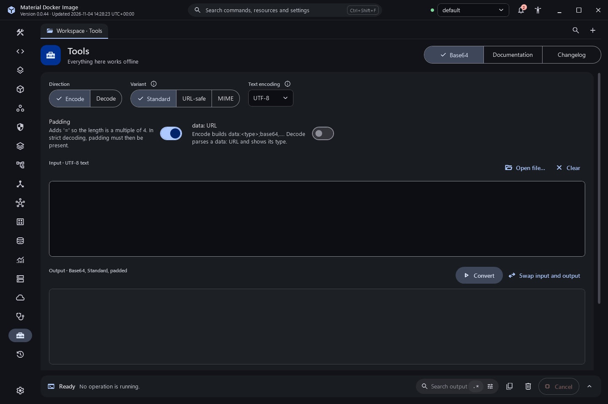
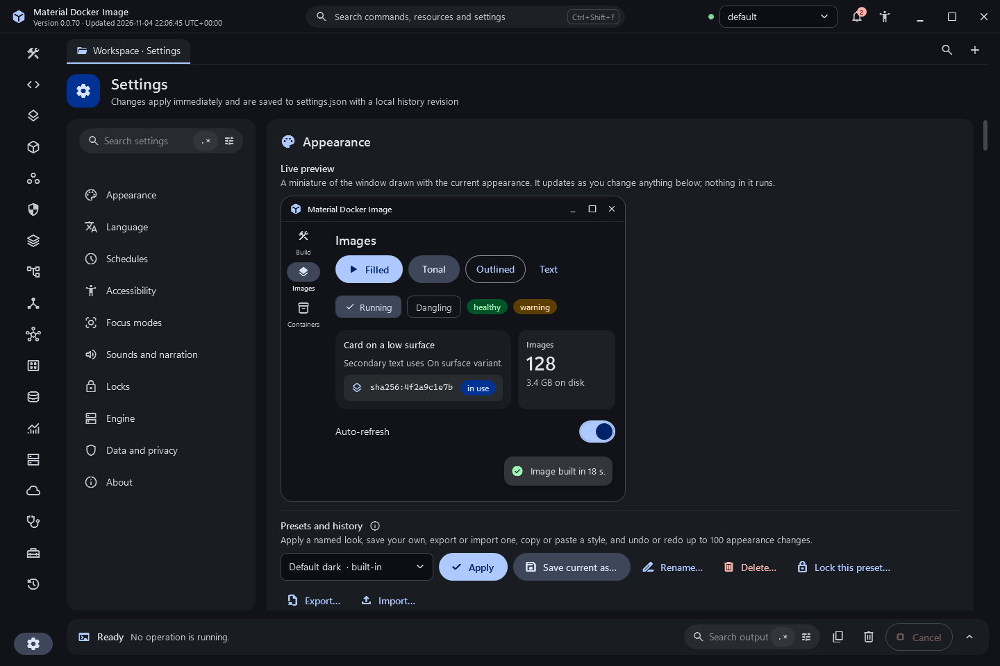

# Monitoring, cleanup, registries and tools

## Monitor

Live CPU and memory charts for the selected container, sampled with `docker container stats` every 1, 2, 5 or 10 seconds while the destination is visible and Live is on. The charts keep the last 120 samples, show a crosshair with time and value, and can be scrubbed with the arrow keys. They state when they are loading, paused, empty or stale, never join gaps between real samples, and stop animating under reduced motion or low stimulation. Container cards show CPU, memory, network and block I/O and process counts, with a search.

## System

Disk usage by images, containers, volumes and build cache from `docker system df`, an engine information card from `docker info` (with its warnings), and client and server versions. Cleanup has independent categories: stopped containers, dangling images, all unused images, unused networks, build cache (optionally older than 24 hours or 7 days) and unused volumes, which is off by default. The super confirmation lists each exact command and the known candidates. Each category runs separately and reports its own result and reclaimed space.

## Storage

Volumes with size, users and filters, a create form with driver options and labels, inspection, removal and prune behind the super confirmation. Networks with driver, scope, subnet and container counts, a create panel with subnet validation and overlap warnings, connect and disconnect, inspection, removal (built-in networks are refused) and prune.

## Registry

Sign in with a user name and a password or access token. The secret is passed to `docker login --password-stdin` on standard input and is never written to arguments, logs, history or settings. The list of signed-in registries reads only registry names from the Docker configuration file. Sign out asks first. Docker Hub search shows stars and official images, with Pull. Buildx builders can be created, inspected, measured, pruned and removed; this application never changes the default builder.

## Diagnostics

Read-only checks for the CLI, engine, API version, Buildx, Compose, contexts, disk usage, registry configuration and container platform, each with its real command, exit code and output. Export a sanitized report as Markdown or JSON after a preview; credentials, environment values and your user profile path are removed. A live engine events stream can be started and filtered. An optional smoke test runs `hello-world` with a unique label and reports creation and cleanup separately.

## Tools

- **Base64**: encode and decode text or files with the standard, URL-safe and MIME alphabets, with or without padding, strict or lenient decoding with the exact error offset, UTF-8, UTF-16LE, Latin-1 or ASCII text, `data:` URL building and parsing, byte counts and SHA-256 checks. Large files stream with progress and Cancel. Nothing leaves the computer.
- **Documentation**: every feature article is bundled into the application and can be searched and read offline.
- **Authenticator**: keeps live one-time codes for any account (otpauth link, a QR picture from an image file or the clipboard, or manual entry; DPAPI-protected, encrypted backup), and pairs an authenticator app with one of the app's own locks (QR code drawn in-process, Base32 secret, a code typed back before the lock arms), checks codes and runs the RFC 6238 vectors; see [Settings safety](settings-safety.md).
  - QR registration: **From an image file…** and **From the clipboard** (a copied picture, a copied image file, or copied `otpauth:` text) decode the QR code in this process with ZXing.Net 0.16.10 and add the account through the same link parser as a pasted link, so its issuer, algorithm, digits and period are kept. Pictures are limited to 20 MB and 40 million pixels; light-on-dark codes are read; a Google Authenticator export code (`otpauth-migration:`) and a code that is not an authenticator link are refused with a reason. The picture is never kept. Camera registration is not built.
- **Changelog**: the running version and build time, the release history bundled at build time with search, date range and Markdown export, and a link to the releases page (see [Records, exports, shortcuts and updates](records-and-updates.md)).

## Settings

Settings are grouped into Appearance, Language, Accessibility, Focus modes, Sounds and narration, Engine, Data and privacy, and About, with a search across sections and individual settings. Each setting explains what it does and says whether its value is the built-in default or was saved. Changes apply immediately and are recorded in local history. Settings can be exported, imported after a preview, and reset behind the super confirmation.

## Screenshots

Captured from the built application ([inventory](../../evidence/inventory.json)).

