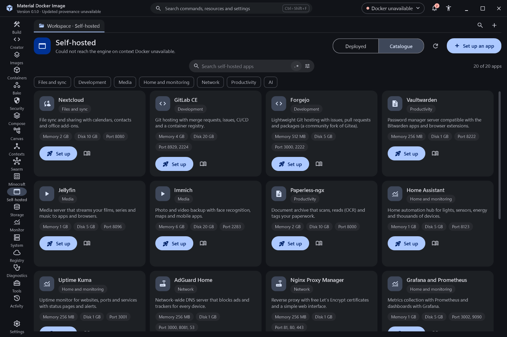
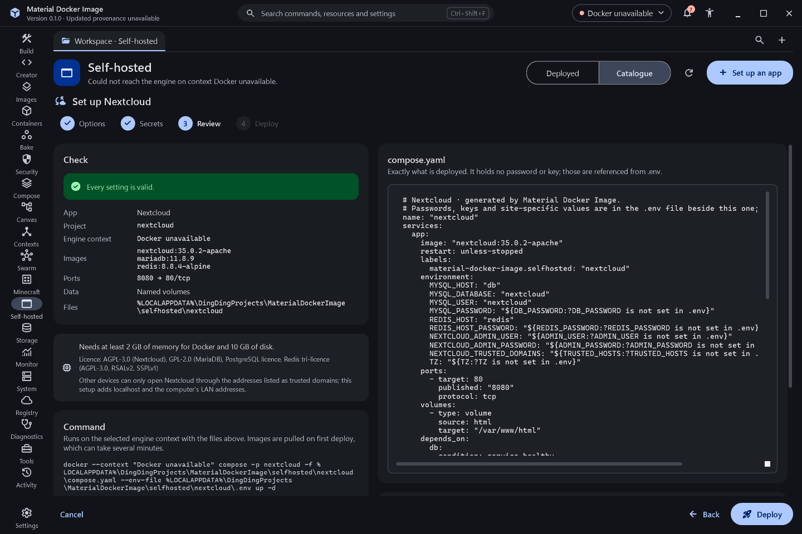

# Self-hosted apps

The Self-hosted destination sets up common self-hosted web apps as Docker Compose projects in a few steps, then manages them. It lists only projects whose containers carry the label `material-docker-image.selfhosted=<app id>`, so Compose projects you created another way are never listed or changed.

## Catalogue

The Catalogue view has a search field with its own anchored regular expression builder and category chips. Every app is pinned to an exact image tag; none uses `latest`.

| App | Category | Images (pinned) | Default host ports | Minimum memory and disk |
| --- | --- | --- | --- | --- |
| Nextcloud | Files and sync | `nextcloud:35.0.2-apache`, `mariadb:11.8.9` or `postgres:17.11-alpine`, `redis:8.8.4-alpine` | 8080 web | 2 GB, 10 GB |
| RustFS object storage | Files and sync | `rustfs/rustfs:1.0.4` | 9001 console, 9000 S3 API | 512 MB, 5 GB |
| Syncthing | Files and sync | `syncthing/syncthing:2.1.7` | 8384 web, 22000 tcp+udp, 21027 udp | 256 MB, 1 GB |
| GitLab CE | Development | `gitlab/gitlab-ce:19.5.3-ce.0` | 8929 web, 2224 SSH | 4 GB, 20 GB |
| Forgejo | Development | `codeberg.org/forgejo/forgejo:17.0.1`, `postgres:17.11-alpine` | 3000 web, 2222 SSH | 512 MB, 5 GB |
| code-server | Development | `codercom/code-server:4.145.2` | 8443 web | 1 GB, 2 GB |
| Jellyfin | Media | `jellyfin/jellyfin:12.4.20261026-211555` | 8096 web | 1 GB, 5 GB |
| Immich | Media | `ghcr.io/immich-app/immich-server:v3.3.6`, `ghcr.io/immich-app/immich-machine-learning:v3.3.6`, `valkey/valkey:9.0.7`, `ghcr.io/immich-app/postgres:14-vectorchord0.4.3-pgvectors0.2.0` | 2283 web | 6 GB, 20 GB |
| Home Assistant | Home and monitoring | `ghcr.io/home-assistant/home-assistant:2026.11.0` | 8123 web | 1 GB, 5 GB |
| Uptime Kuma | Home and monitoring | `louislam/uptime-kuma:2.5.9` | 3001 web | 256 MB, 1 GB |
| Grafana and Prometheus | Home and monitoring | `grafana/grafana:13.3.0`, `prom/prometheus:v3.16.0` | 3002 Grafana, 9090 Prometheus | 1 GB, 5 GB |
| AdGuard Home | Network | `adguard/adguardhome:v0.107.80` | 3000 first-run setup, 8081 web, 53 DNS tcp+udp | 256 MB, 1 GB |
| Nginx Proxy Manager | Network | `jc21/nginx-proxy-manager:2.16.0` | 81 admin, 80 HTTP, 443 HTTPS | 256 MB, 1 GB |
| Vaultwarden | Productivity | `vaultwarden/server:1.37.5` | 8222 web | 256 MB, 1 GB |
| Paperless-ngx | Productivity | `ghcr.io/paperless-ngx/paperless-ngx:3.4.2`, `redis:8.8.4-alpine`, `postgres:17.11-alpine` | 8000 web | 2 GB, 10 GB |
| n8n | Productivity | `n8nio/n8n:2.46.6` | 5678 web | 1 GB, 2 GB |
| WordPress | Productivity | `wordpress:7.1.4-apache`, `mariadb:11.8.9` | 8085 web | 512 MB, 2 GB |
| BookStack | Productivity | `lscr.io/linuxserver/bookstack:version-v26.09.2`, `mariadb:11.8.9` | 6875 web | 512 MB, 2 GB |
| FreshRSS | Productivity | `freshrss/freshrss:1.30.4` | 8086 web | 128 MB, 1 GB |
| Open WebUI and Ollama | AI | `ghcr.io/open-webui/open-webui:v0.13.3`, `ollama/ollama:0.40.15` | 3003 web | 8 GB, 20 GB |

MinIO is not offered: its community container images are no longer published or pullable (the last release tag on Docker Hub and quay.io returned "not found" or "access denied"). RustFS, an Apache-2.0 S3-compatible server with a similar console, takes its place.

Every tag above was checked against its registry on 9 November 2026 with `docker buildx imagetools inspect`; the index digests are in `evidence/selfhosted-2026-11.json`. Tags were chosen from each project's latest stable release (GitHub "latest release" or the registry tag list), and the Immich layout follows the `docker-compose.yml` attached to its v3.3.6 release.

Each card shows the description, category, minimum memory and disk, default ports, a Set up button and a link to the upstream documentation. The licence of each app is shown in the setup wizard.

## Set up an app

The wizard has four steps.

1. **Options**
   - **Project name**: lowercase letters, digits, dashes and underscores. It is checked against the Compose projects the engine already reports and the project folders this app has written.
   - **Ports**: one host port per published container port. Each is checked for duplicates inside the setup, against ports published by running containers on the selected engine context, and, for a local engine, against TCP and UDP listeners on this computer. A taken default moves to the next free port.
   - **Data**: Docker named volumes (default) or a folder you choose. In folder mode each volume gets `<folder>\<project>\<volume>`; database volumes stay named volumes because databases on Windows folders are slow and can fail ownership checks.
   - **Database**: Nextcloud offers MariaDB or PostgreSQL.
   - **Settings**: time zone (defaults to this computer's zone converted to its IANA name), the address the app uses in links it builds (a LAN address of this computer by default, or the remote engine host), and the administrator name or e-mail for apps that create their administrator from setup values.
   - The minimum memory and disk, the licence and any limits of running the app on Docker Desktop are shown under the options.
2. **Secrets**: passwords and keys are generated with the system's cryptographic random number generator (letters and digits, 20 to 50 characters; BookStack gets a Laravel `base64:` key of 32 random bytes). They are shown only in this step, masked until you choose Show, with Copy buttons and a warning. Generate new values replaces them.
3. **Review**: the exact `compose.yaml` in a read-only editor, the `.env` file with every secret masked, the images, ports, data location, engine context, the deploy command and the resource needs.
4. **Deploy**: writes the files, runs `docker compose -p <project> -f compose.yaml --env-file .env up -d` on the selected engine context with streamed output in the operation panel, then waits for the app. Waiting ends when an HTTP GET to the app's health path answers with a status below 500, when a container reports unhealthy or stops with an error, when the app's time limit passes (4 minutes by default, 12 for GitLab) or when you choose Stop waiting.

The result shows:

- the local address (`http://localhost:<port>`), or the engine host's address when the context is remote;
- one address for each LAN IPv4 address of this computer, labelled with the adapter name. Only adapters that are up, are not loopback and are not virtual (Hyper-V, WSL, VirtualBox, VMware, Docker, VPN and tunnel adapters) are used, link-local addresses are skipped, and nothing is invented when none is found;
- a note that Docker Desktop publishes ports on every interface but Windows Firewall may still need to allow the port for other devices;
- the first sign-in hint (where the administrator account is created);
- Open in browser (the default browser), Copy URL and Open in Compose (opens the project's `compose.yaml` in the Compose destination).

## Files

Each project has a folder `%LOCALAPPDATA%\DingDingProjects\MaterialDockerImage\selfhosted\<project>\` with:

- `compose.yaml`: no password or key. Values that are secret or site-specific are references such as `${DB_PASSWORD:?DB_PASSWORD is not set in .env}`, so Compose refuses to start when the value is missing instead of starting with an empty password. Every service has `restart: unless-stopped` and the self-hosted label, and every named volume carries the label.
- `.env`: the time zone, address, administrator name, host ports and the generated secrets. It is created with an access list that lets only the current Windows account read it, before any secret is written. Values are single-quoted when they contain anything beyond simple token characters, so Compose does not interpolate them.
- `selfhosted.json`: the non-secret options and the images used, so Update can re-render `compose.yaml`.

Secrets are never written to logs, local history, notifications, exports or captures, and are masked in every command preview.

## Manage projects

The Deployed view lists each labelled project with its state, address, containers, and CPU and memory from one `docker stats` sample. Row actions:

- **Open in browser**, **Start**, **Stop**, **Restart** (Compose start, stop and restart for the project).
- **Update…**: re-renders `compose.yaml` with the images pinned in this version of the app (the `.env` file and its secrets stay as they are), shows a confirmation that lists each image that changes from its current to its new tag, then runs `compose pull` and `compose up -d`.
- **Logs**: follows `docker compose logs` in the log viewer with search and its regex builder.
- **Show compose file** and **Open in Compose**.
- **Back up data…**: copies each named volume of the project into a `tar.gz` archive in `Documents\Docker volume backups\<project>-<time>` with the same helper as Storage › Volumes. Stopping the project during the backup is on by default when it is running. Only local engines are supported here.
- **Remove…**: removes the containers and network (`compose down`). Volumes, a data folder and the project files are kept unless you turn on **Also delete data**, which needs the two-key super confirmation and then also removes the volumes, the data folder and the project files (including `.env`).

## Limits

- The address for links is fixed when the app is set up; apps such as GitLab, WordPress and BookStack keep the address they were installed with.
- Home Assistant runs with a published port instead of host networking, so automatic discovery of LAN devices is limited. Syncthing's local discovery does not cross the Docker Desktop network.
- Vaultwarden's web vault needs HTTPS (or localhost) in browsers; put it behind a reverse proxy with a certificate before using it from other devices.
- GitLab needs at least 4 GB of memory for Docker (8 GB recommended) and 5 to 10 minutes for its first start.
- No GPU acceleration is configured (Jellyfin transcoding, Immich machine learning and Ollama run on the CPU).

## Verification

- UI-state checks (`tests/UiState/SelfHostedChecks.cs`): catalogue completeness, pinned tags, every app and option variant rendered (each database choice, named volumes and folder mode) with secrets only in `.env`, labels and restart policies on every service, every published port on its chosen host port, every `${VAR}` defined in `.env`, re-rendering from the saved settings, masking, validation of names, ports, folders, time zones and administrators, secret generation, LAN adapter filtering, `docker ps` parsing and Cantonese coverage. When the Docker CLI with Compose is present, `docker compose config` must accept all 42 rendered variants, and a project whose `.env` lacks a referenced secret must be refused. Each check was seen failing under a deliberate break before it was restored.
- Real deployments of Uptime Kuma and FreshRSS with the same rendering code are recorded in `evidence/selfhosted-2026-11.json`: files written (the `.env` access list held only the current account), `compose config` and `up -d` exited 0, the health path answered, `http://localhost:<port>/` answered from Windows, and `down --volumes` left nothing behind. Docker Desktop could not start on that machine at the time, so the Docker Engine in a WSL distribution was used; its NAT networking does not forward the computer's LAN address, so the LAN probe was refused there.
- A later run on Docker Desktop drove the built application itself (`windowDrive` in the same file): Uptime Kuma was set up through the wizard, the LAN address it listed answered from another device on the same network, and stop, start, logs, backup and removal with deleted data worked and left nothing behind. A second run (`windowDriveActions`) drove restart, show compose file, update and open in Compose.
- Captures of the destination, the catalogue and a filled review page come from capture mode, which never writes project files or deploys. The set in `evidence/selfhosted-captures-2026-11/` (1440 x 960, 960 x 720 and Cantonese, each with its layout probe file reporting no cut, overflow or truncated text) was taken from the built application on a hidden desktop with the Docker CLI off the path, so the Deployed view shows its engine error card.

- Not yet exercised: the wizard and the management actions clicked through in the built window against a real engine, Update and Back up against a running project, and apps other than the one deployed.
