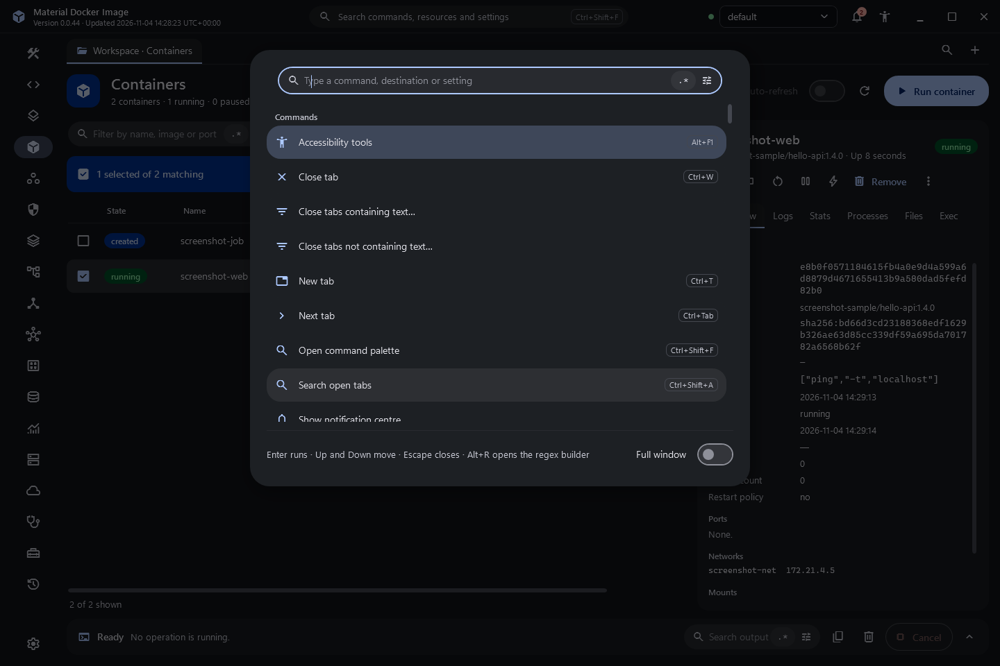
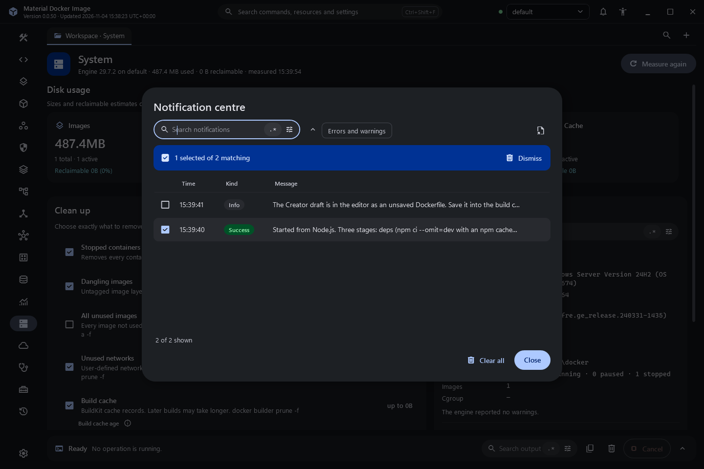
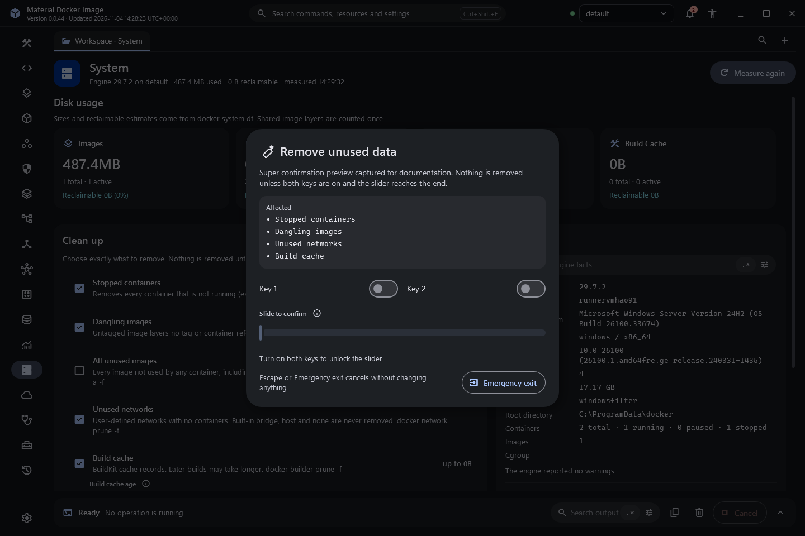
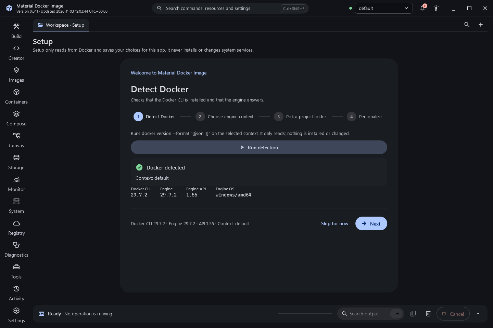

# Workspace, navigation and command palette

The application opens into a productive workspace in a frameless Material 3 window.

## Title bar

- Application name (renamable in Settings, About), the running version and the updated-at time of that build, with seconds and the UTC offset. Both come from metadata compiled into the running executable; when it is missing the title bar says "provenance unavailable".
- The command palette entry. `Ctrl+Shift+F` opens it from anywhere.
- The engine context selector. It changes only which context this window uses; the global Docker context is never changed. The dot beside it is green when the engine answered a version check, red when it did not.
- Notifications with an unread count, the accessibility tools menu, and minimize, maximize or restore, and close.

## Destinations and tabs

The navigation rail lists Build, Creator, Images, Containers, Compose, Canvas, Storage, Monitor, System, Registry, Diagnostics, Tools, Activity and, at the bottom, Settings. `Ctrl+1` to `Ctrl+9` open the first nine.

The first tab is the project workspace tab, named after the build folder. Rail navigation changes what the current tab shows and never adds tabs. New tab (`Ctrl+T`) opens a searchable catalog of every destination; choosing a destination that already has a tab focuses that tab instead of duplicating it. Tabs can be pinned, moved left or right, closed (`Ctrl+W`, middle click), and closed in bulk by text with a preview. Pinned tabs and the workspace tab are never closed in bulk. Open and pinned tabs are restored on the next start. `Ctrl+Shift+A` searches open tabs.

## Command palette

The palette lists every command, destination and setting. Rows for settings contain the real control (for example the theme selector or the reduced motion switch), wired to the same setting as the Settings page. Enter runs the highlighted command, the arrow keys move, Escape closes. The palette has its own search with a regular expression mode and builder (`Alt+R`), and a persisted full-window size.

## Search everywhere

Every list, table, menu, log and source viewer has its own search field. It matches plain text by default and has a `.*` regular expression toggle. The builder button next to the toggle, a right-click on the toggle, or `Alt+R` opens that field's own builder, which offers guided insertion, flags, an explanation tree, a bounded live test, a replace preview, a snippet library and saved patterns. Each search keeps its own state. See [Search and the regular expression builder](search-and-regex.md) for the engine, the limits and the tab bulk close commands.

## Lists

Tables support multi-select (click, Shift and Ctrl), select all matching, invert selection, a bulk action bar that states the exact count, row context menus with a filter field and their working shortcuts, filter chips, and export of the visible rows as CSV, TSV, JSON or Markdown.

## Notifications

Information and success messages appear as toasts in the bottom right corner and dismiss themselves. Warnings and errors stay until dismissed. The notification centre keeps dismissed messages with search, filters, copy and bulk dismiss. Modal dialogs are used only for real decisions.

## Destructive actions

Removing data uses a two-key super confirmation: it names the action and every affected item, needs both keys before the slider unlocks, acts only when the slider reaches the end, and always offers Emergency exit and Escape.

## Operation panel

Long operations stream their real output into the collapsible panel at the bottom (`Ctrl+J`) with elapsed time, a Cancel button and its own search. Only one foreground operation runs at a time. Cancellation is reported as cancellation, never as success.

## Screenshots

Captured from the built application ([inventory](../../evidence/inventory.json)).

